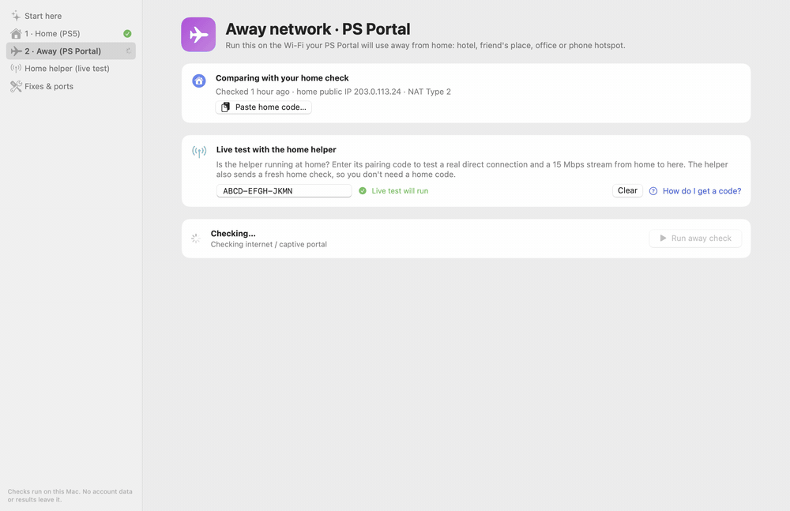
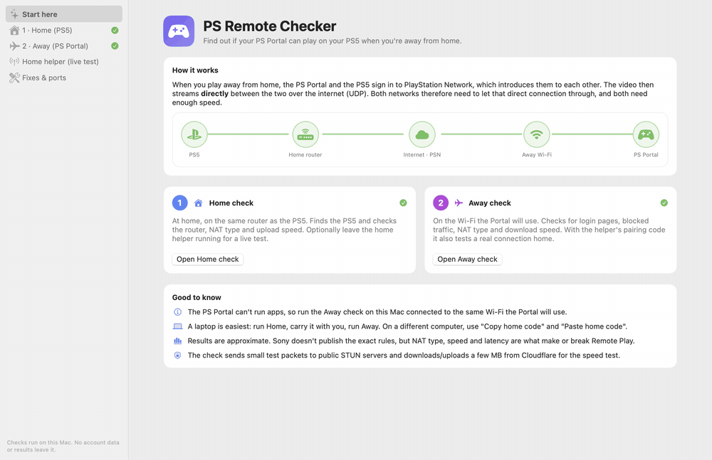
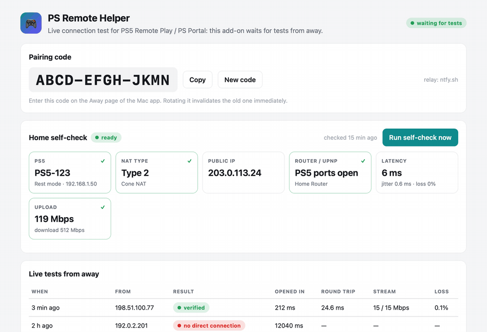
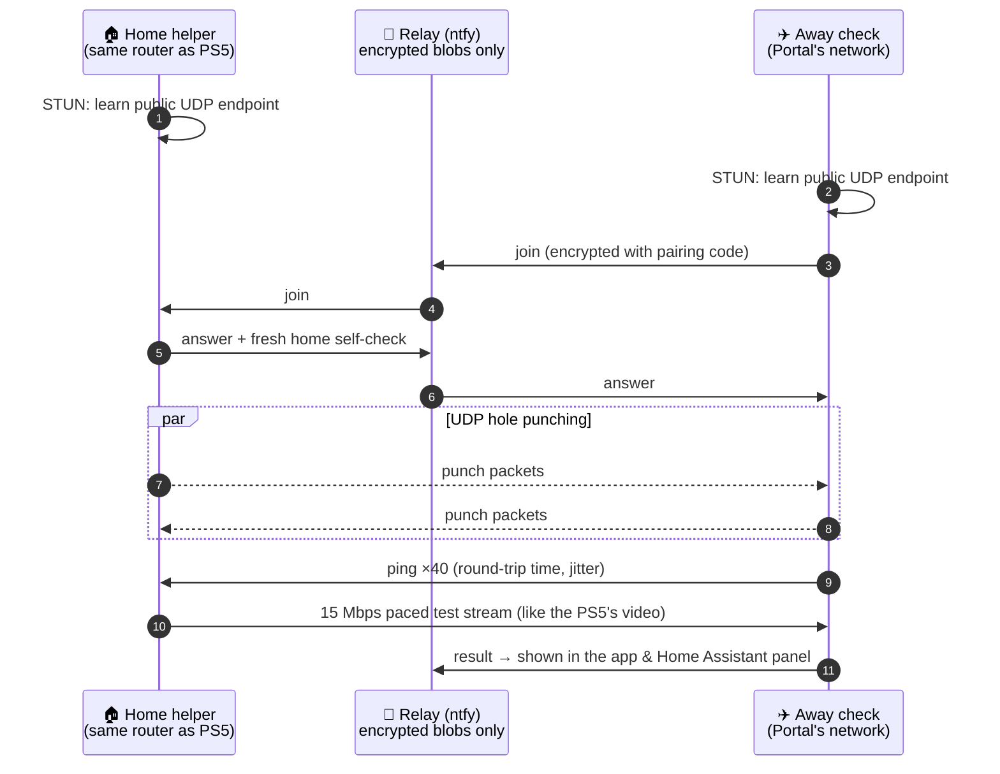

<div align="center">


# PS Remote Checker

**Will your PS Portal reach your PS5 from the hotel? Find out before you pack.**

A network checker for **PS5 Remote Play** and the **PlayStation Portal**. It tests your home network and the network
you'll play from, and can also *prove* the connection with a live test between the two.

[](https://github.com/konraddzbik/ps-remote-checker/actions/workflows/tests.yml)


[Features](#-features) · [How it works](#-how-it-works) · [Quick start](#-quick-start) · [Live test](#-live-test-home-helper) ·
[Home Assistant](#-home-assistant-add-on) · [Security](#-security--privacy) · [FAQ](#-faq)



</div>

---

## 🤔 Why?

The PS Portal is great until you try it away from home and get *"Cannot connect to the PS5"*. Remote Play over the
internet depends on things neither the PS5 nor the Portal shows you:

- 🧱 **NAT types on *both* networks.** The video streams **peer-to-peer over UDP**, so both routers must let it through.
- 🏢 **Carrier-grade NAT or double NAT** at home, which makes port forwarding silently do nothing.
- 🏨 **Hotel, office and campus Wi-Fi** that blocks UDP or hides behind a login page.
- 📶 **Upload speed at home.** The PS5 *sends* the video, so your home upload is the bottleneck.

**PS Remote Checker** checks all of this from a Mac or the command line, tells you in plain words whether it will work,
and if not, what to change.

## ✨ Features

| | |
|---|---|
| 🏠 **Home check** | Finds the PS5 on your LAN (on or in rest mode) and checks the NAT type, UPnP, the PS5's port mappings, CGNAT / double NAT, latency and upload speed |
| ✈️ **Away check** | On the network the Portal will use: captive portal, PlayStation Network reachability, UDP blocking, NAT type, latency and download speed |
| ⚖️ **Combined verdict** | *Should work / may work / won't work*, with the reason and a concrete fix for every problem |
| 🔬 **Live test** | A home helper and the away check open a **real direct UDP connection**, the same way PSN connects the PS5 and Portal, and stream **15 Mbps** of test traffic |
| 🖥️ **Native macOS app** | SwiftUI, light and dark mode, guided steps, a built-in fixes and ports guide |
| 🏡 **Home Assistant add-on** | Runs the helper on your HA box, with a sidebar panel that works over Tailscale |
| 🍓 **Raspberry Pi kit** | A one-command systemd install for any always-on Linux box |
| 🪶 **Zero dependencies** | Pure Python standard library, so it runs on macOS, Linux, Windows and Home Assistant |

<table>
<tr>
<td width="50%"><br><sub><b>macOS app</b>: Start, Home, Home helper, Fixes & ports, dark mode</sub></td>
<td width="50%"><br><sub><b>Home Assistant panel</b>: pairing code, hourly self-check, live test history</sub></td>
</tr>
<tr>
<td colspan="2"><br><sub><b>CLI</b>: <code>ps-remote-check remote --pair …</code></sub></td>
</tr>
</table>

<sub>All screenshots use made-up demo data (documentation IP ranges, a fake PS5 name and pairing code).</sub>

## 🧠 How it works

When you play away from home, the PS5 and PS Portal both sign in to PlayStation Network, which **introduces them to
each other**. The video then flows **directly** between them over UDP. That only works if both NATs let the packets
through (or the PS5's ports are open). PS Remote Checker measures exactly that.



<details>
<summary><b>What exactly is checked</b></summary>

| Check | Home (PS5) | Away (Portal) | Why it matters |
|---|:---:|:---:|---|
| PS5 discovery (UDP 9302, Remote Play discovery protocol) | ✅ | | Confirms the PS5 is on the LAN, and whether it's on or in rest mode |
| NAT type via STUN (mapping behaviour) | ✅ | ✅ | Decides whether UDP hole punching can work |
| UPnP, router WAN IP, CGNAT / double NAT | ✅ | | Whether the PS5 can open ports, and whether forwarding can work at all |
| UPnP port mappings pointing at the PS5 | ✅ | | Proves the PS5 really opened its ports |
| UDP latency, jitter, loss | ✅ | ✅ | Stutter and disconnects |
| Bandwidth | upload | download | The PS5 sends the video and the Portal receives it. Sony recommends ≥ 15 Mbps (minimum 5) |
| Captive portal | | ✅ | Hotel login pages block the Portal |
| PlayStation Network reachability | | ✅ | Sign-in and session brokering |
| **Live test** (direct UDP + 15 Mbps stream) | helper | ✅ | Proof instead of prediction |

</details>

<details>
<summary><b>How the verdict is reached</b></summary>

| Home side | Away side | Result |
|---|---|---|
| Live test connected over the internet | | ✅ **verified** |
| Ports open (public IP, or UPnP mappings for the PS5 without CGNAT / double NAT) | any NAT that allows UDP | ✅ should work |
| Cone NAT (≈ NAT Type 2) | Cone NAT | ✅ hole punching should work |
| Cone | Symmetric (≈ NAT Type 3), or vice versa | ⚠️ may work |
| Symmetric | Symmetric | ❌ won't connect |
| any | UDP blocked / captive portal / PSN unreachable | ❌ |

</details>

## 🚀 Quick start

### 🖥️ macOS app

```bash
git clone https://github.com/konraddzbik/ps-remote-checker.git
cd ps-remote-checker
macos/build.sh                          # universal app (Apple silicon + Intel)
open "macos/build/PS Remote Checker.app"
```

1. **1 · Home (PS5):** on the PS5's network, click *Run home check*.
2. **2 · Away (PS Portal):** on the Wi-Fi the Portal will use (or a phone hotspot), click *Run away check*.

> Building needs the Xcode Command Line Tools. Running needs any Python 3.9+ (Homebrew, python.org or the one that comes
> with the Command Line Tools), because the checker engine is bundled inside the app. When macOS asks to find devices on
> your local network, click **Allow**.

### ⌨️ Command line (macOS · Linux · Windows)

```bash
# 1) at home, on the PS5's network
python3 -m ps_remote_checker home -o home.json

# 2) away, on the Portal's network
python3 -m ps_remote_checker remote --home home.json

# or compare two saved reports later
python3 -m ps_remote_checker compare home.json remote.json
```

Install it as a command with `pip install .` to get `ps-remote-check`. Without `-o`, `home` prints a short **home code**
(`PSRC1.…`) that you can paste into `--home` instead of carrying a file.

<details>
<summary>All CLI options</summary>

| Command | Option | |
|---|---|---|
| `home` | `--ps5-ip IP` | PS5 address if broadcast discovery fails |
| `home`, `remote`, `helper` | `--no-speed`, `--speed-seconds N` | Skip or shorten the bandwidth test |
| `home`, `remote` | `-o FILE` | Save the JSON report |
| `remote` | `--home FILE\|CODE` | Home report for the combined verdict |
| `remote` | `--pair CODE` | Run the live test against a home helper |
| `remote` | `--live-mbps N`, `--live-seconds N` | Live stream rate / duration (default 15 Mbps, 6 s) |
| `remote`, `helper` | `--relay URL` | Your own ntfy server instead of ntfy.sh |
| `helper` | `--code CODE`, `--no-home-check` | Fixed pairing code; skip the hourly self-check |
| global | `--json` | Machine-readable output (progress on stderr) |

Exit code: `0` = OK or warnings, `1` = something blocks Remote Play.

</details>

## 🔬 Live test (home helper)

The checks *predict*. The live test *proves*. Leave a **helper** running on any always-on device behind your home
router, and the away check connects to it the way the PS Portal connects to the PS5.

| Where the helper runs | How |
|---|---|
| 🏡 **Home Assistant** | [Install the add-on](#-home-assistant-add-on) (recommended if you have HA) |
| 🍓 **Raspberry Pi / Linux / NAS** | In the Mac app: *Home helper › Save Raspberry Pi kit…*, then `sudo ./install.sh` on the Pi |
| 🖥️ **A Mac that stays home** | In the Mac app: *Home helper › Start helper* (keeps the Mac awake) |
| ⌨️ **Anything with Python** | `python3 -m ps_remote_checker helper` |

Then, away from home: enter the **pairing code** on the app's *Away* page, or run
`python3 -m ps_remote_checker remote --pair ABCD-EFGH-JKMN`.

> [!TIP]
> Turn **Tailscale (or any VPN) off** on the testing laptop. Otherwise the test may go through the tunnel instead of the
> real internet path the Portal will use.

<details>
<summary>Raspberry Pi / Linux as a systemd service</summary>

```bash
scp -r ps-remote-helper pi@raspberrypi.local:~                  # kit from the app, or ps_remote_checker/ + deploy/rpi/install.sh
ssh pi@raspberrypi.local 'sudo ~/ps-remote-helper/install.sh'   # reads pairing-code.txt, or pass the code as an argument
ssh pi@raspberrypi.local journalctl -u ps-remote-helper -f
```

The installer copies the checker to `/opt/ps-remote-checker` and runs it as the unprivileged `psrc` user via the
`ps-remote-helper` service (auto-restart, starts on boot).

</details>

## 🏡 Home Assistant add-on

[](https://my.home-assistant.io/redirect/supervisor_add_addon_repository/?repository_url=https%3A%2F%2Fgithub.com%2Fkonraddzbik%2Fps-remote-checker)

1. Click the button above, or add `https://github.com/konraddzbik/ps-remote-checker` under
   *Settings › Apps (Add-ons) › Store › ⋮ › Repositories*.
2. Install **PS Remote Helper** and start it. It builds on your device in under a minute.
3. Open **PS Remote** in the sidebar. It works over Tailscale or Nabu Casa, behind your HA login.

The panel shows the pairing code (copy / rotate), an **hourly home self-check** (PS5, NAT type, UPnP, upload) and the
history of every live test. Options: `pairing_code`, `relay`, `ps5_ip`, `self_check_speed_test`.
Runs on `aarch64`, `amd64` and `armv7` (Raspberry Pi 4/5, Home Assistant Green/Yellow, x86).

## 🛠️ Typical fixes

- **Enable UPnP** on the home router, then on the PS5 run *Settings › Network › Connection Status › Test Internet Connection*.
- Or give the PS5 a fixed IP and **forward** TCP `9295`, UDP `9296–9297` and UDP `9302–9304` to it.
- **CGNAT** (router WAN IP in `100.64.0.0/10`): forwarding can't work. Ask your ISP for a public IPv4 address.
- **Double NAT**: put the ISP modem in bridge mode, or forward on both routers.
- PS5: enable *Remote Play*, and in *Power Saving* turn on *Stay connected to the internet* and *Enable turning on PS5 from network*.
- Wire the PS5 with Ethernet. Away, prefer 5 GHz Wi-Fi. A **phone hotspot** is the classic fallback for restrictive Wi-Fi.
- Hopeless network? A **travel router with WireGuard/Tailscale back home** tunnels around hotel restrictions. The Portal just joins the travel router's Wi-Fi.

## 🔐 Security & privacy

- **No accounts, no PSN login, nothing touches your PS5.** The checks only observe your network.
- **No port forwarding needed for the live test.** The helper opens a UDP path only during a test, only for packets
  authenticated with the pairing code, and only for about 30 s.
- **The relay can't read anything.** The ntfy topic is derived from the code, and messages are encrypted and authenticated
  (SHA-256 keystream + HMAC-SHA256, encrypt-then-MAC). The code itself never leaves your devices. You can self-host the
  relay with `--relay`.
- **The helper can't be used to flood others.** The test stream only goes to an address that proved it can receive
  there (return-routability cookie), and is capped at 30 Mbps / 15 s, max one test every 20 s and 12 per hour.
- **Home Assistant add-on:**
  - the panel is only reachable through Ingress (other clients get 403, even with host networking);
  - change requests need a custom header (CSRF);
  - the process drops root;
  - it has no Home Assistant / Supervisor API access;
  - the pairing code is never written to logs.
- **What's visible to someone with your pairing code:** your home's public IP (inherent to any peer-to-peer
  connection, PSN included), and they can trigger rate-limited tests. Rotate the code if it leaks.

> [!NOTE]
> The crypto uses Python's standard library only (no AES available), via a standard encrypt-then-MAC construction.
> It protects IP addresses and ports in transit. It isn't meant for anything more sensitive.

## ❓ FAQ

<details>
<summary><b>Can't I run this on the PS Portal itself?</b></summary>

No, the Portal can't run apps. Run the away check on a laptop connected to **the same Wi-Fi** the Portal will use (or
your phone's hotspot). That network is what matters.
</details>

<details>
<summary><b>The live test failed, but Remote Play works. How?</b></summary>

The helper stands in for the PS5 behind the same router. If the PS5 opened its own ports via UPnP, it can still be
reachable when the helper isn't. The verdict accounts for this and reports *may work* rather than *fail*.
</details>

<details>
<summary><b>Why does it say "local network only"?</b></summary>

Both ends were on the same network, so they connected over the LAN. Test from the real away network or a phone hotspot,
with VPNs off.
</details>

<details>
<summary><b>What's "Type 2" / "Type 3"?</b></summary>

PlayStation's NAT types. Type 2 ≈ cone NAT (hole-punching friendly), Type 3 ≈ symmetric NAT (strict). Type 3 on
*both* sides is the classic reason Remote Play can't connect.
</details>

<details>
<summary><b>Does it work for the PS Remote Play app on a phone or PC?</b></summary>

Yes, it's the same Remote Play protocol and network requirements.
</details>

## 🧩 Project layout

```
ps_remote_checker/        Python engine + CLI (stdlib only)
  stun.py  upnp.py  discovery.py  netinfo.py  speed.py   network probes
  relay.py  pairtest.py                                  live test (signalling + UDP protocol)
  verdict.py  cli.py                                     findings, verdicts, output
macos/                    SwiftUI app (bundles the engine) · build.sh · Tools/Snapshot.swift
homeassistant/            Home Assistant add-on (Ingress panel) · sync.sh
deploy/rpi/install.sh     Raspberry Pi / Linux systemd installer
docs/tools/               reproducible README media from fictional demo data
tests/                    unit + loopback protocol tests
```

## 🧪 Development

```bash
python3 -m unittest discover -s tests -v   # stdlib only, no network needed
macos/build.sh                             # build the macOS app
homeassistant/sync.sh                      # copy the engine into the add-on (a test enforces this)
docs/tools/make_media.sh                   # regenerate the GIFs/screenshots (macOS + ffmpeg)
```

When releasing an add-on update, run `homeassistant/sync.sh` and bump `version` in
`homeassistant/ps_remote_helper/config.yaml`, so Home Assistant offers the update.

## ⚖️ Disclaimer

This is an independent, unofficial tool and isn't affiliated with, endorsed by, or connected to Sony Interactive
Entertainment. *PlayStation*, *PS5*, *PlayStation Portal* and *PS Remote Play* are trademarks of Sony Interactive
Entertainment Inc. Apart from the console's local discovery broadcast (used to find the PS5 on your LAN), it doesn't
talk to the PS5, the PS Portal or PlayStation Network on your behalf, and it doesn't touch the Remote Play streaming
protocol. It only measures whether your networks can carry it.

<div align="center"><sub>Made for everyone who's seen "Cannot connect to the PS5" in a hotel room. 🎮</sub></div>
